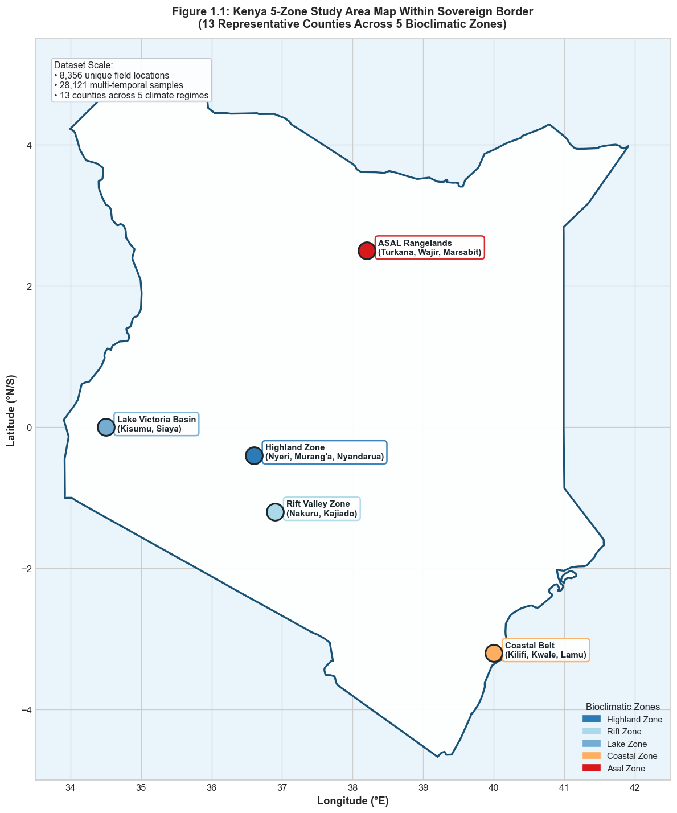
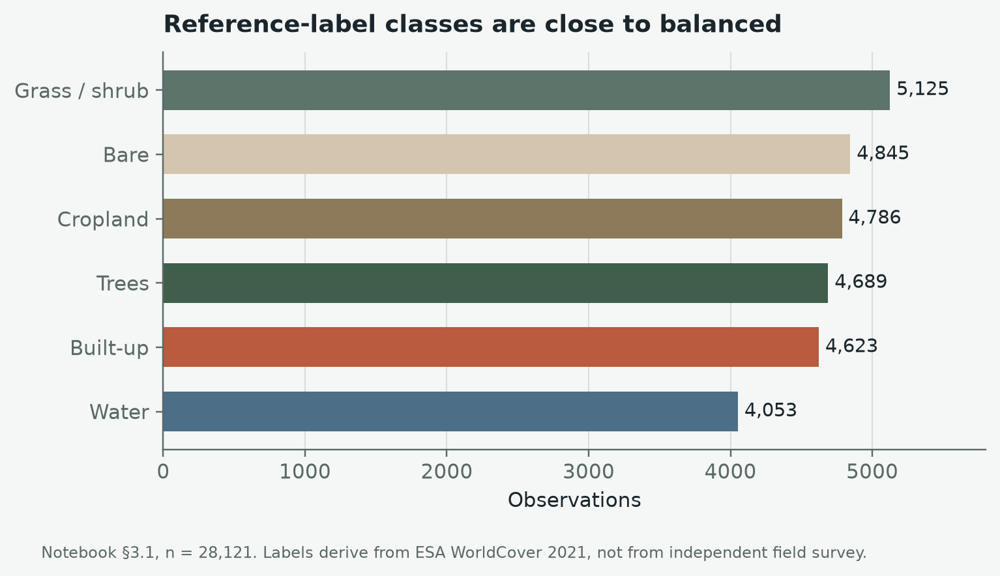
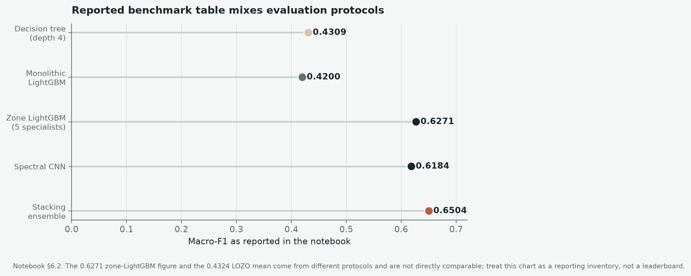
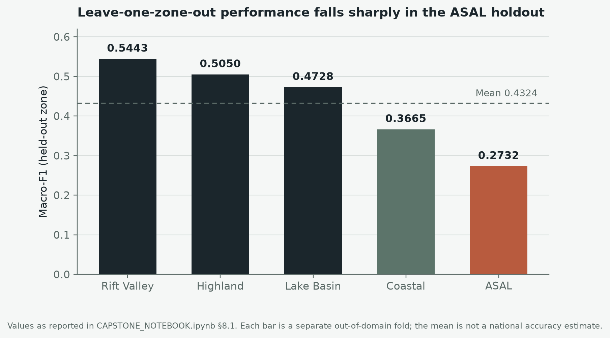
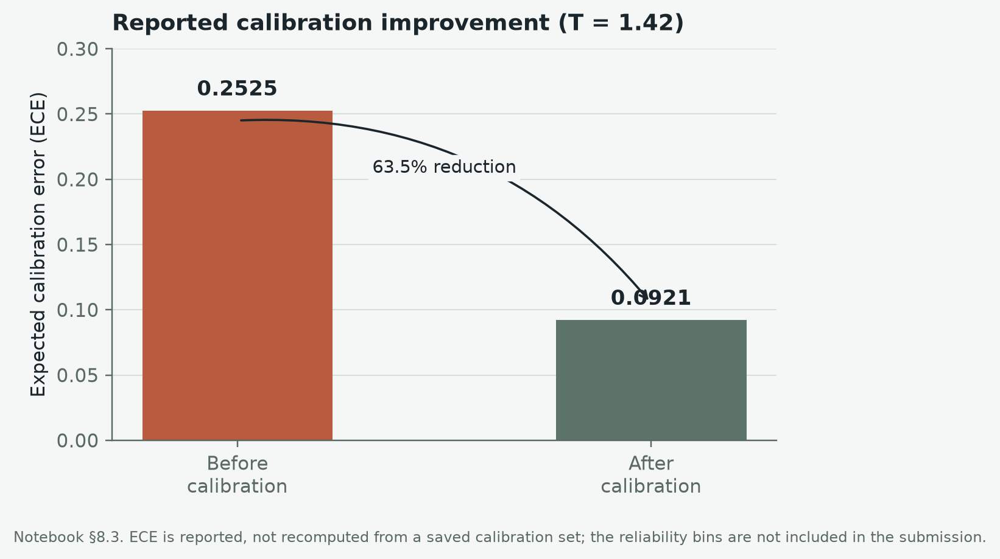
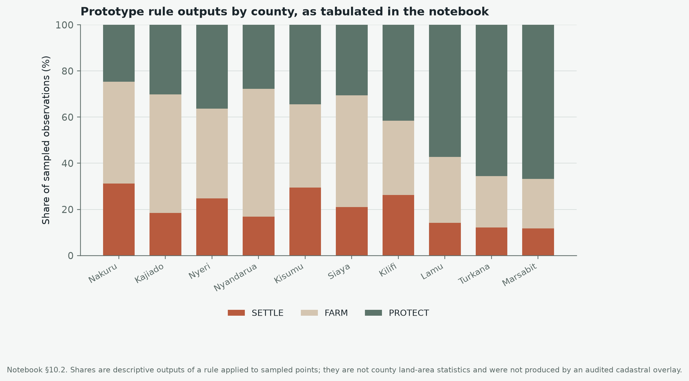
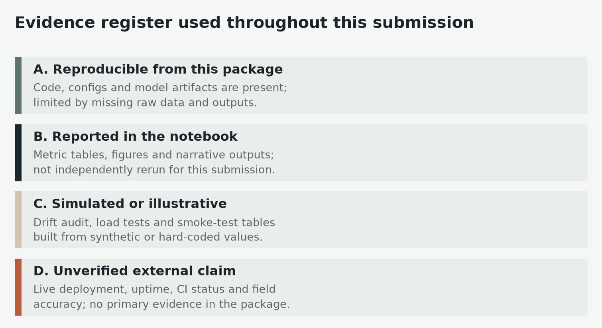

# Kenya Land Readiness Atlas

## A spatial machine-learning prototype for land-cover screening and statutory land-use triage

**Programme:** MSc Data Science and Analytics, Strathmore University (iLabAfrica)  
**Course:** DSA 8401 Applied Machine Learning  
**Candidate:** Valerie Jerono  
**Supervisors:** Dr Javier Serrano and Dr Emmanuel Bundi  
**Submission:** November 2026  
**Repository:** <https://github.com/VAL-Jerono/Satellite>

---

## Abstract

Land-use decisions in Kenya are routinely made with spatial evidence that is either too coarse, too old, or too difficult to interpret. This capstone investigates whether openly available Earth-observation data, engineered spectral features, and spatially honest validation can support a practical first-pass screening service that separates land that may be suitable for settlement, agriculture, or conservation. The prototype combines Sentinel-2 Level-2A surface reflectance, SRTM terrain derivatives and CHIRPS rainfall over 28,121 sampled observations in five bioclimatic zones, with ESA WorldCover 2021 used as the reference label source. It engineers 27 spectral, topographic and phenological features, partitions Kenya into 0.05° blocks with a one-block buffer, trains five zone-specific LightGBM classifiers alongside a 10-channel spectral CNN, and combines their outputs through a stacking meta-learner. A transparent rule layer maps model outputs and terrain attributes to three provisional actions: SETTLE, FARM and PROTECT.

The notebook reports a leave-one-zone-out mean macro-F1 of 0.4324, with performance ranging from 0.5443 in the Rift Valley holdout to 0.2732 in the arid and semi-arid lands holdout. It also reports a stacking ensemble macro-F1 of 0.6504 and a reduction in expected calibration error from 0.2525 to 0.0921 after temperature scaling. These are notebook-reported values; they were not independently reproduced during the preparation of this report, and the benchmark table mixes evaluation protocols that are not directly comparable.

The project's principal contribution is not a claim of field accuracy. It is an integrated, inspectable workflow: reproducible data preparation, spatially blocked validation, calibrated probabilities, a rule layer that can be audited, and a serving stack. The submission also documents where the evidence stops. Reference labels are model-derived rather than field-surveyed; the raw observation table and several evaluation outputs are not included; some operational results in the notebook are simulated demonstrations; and the legal thresholds encoded in the prototype require correction and review by qualified counsel. Read as a screening prototype with an explicit evidence boundary, the work provides a credible foundation for a county-level decision-support system. Read as a validated cadastral or legal instrument, it would overstate what has been demonstrated.

**Keywords:** land-cover classification; Sentinel-2; spatial cross-validation; LightGBM; calibration; Kenya; land-use planning; decision support; MLOps

---

## Executive summary

Kenya's planning and investment decisions depend on questions that are spatial before they are financial: where can housing be built without entering a floodplain, which farmland should be protected from conversion, and which landscapes should not be developed at all. The evidence needed to answer those questions is often assembled parcel by parcel, at considerable cost and delay, and county planning records are frequently incomplete or out of date.

This project tests a narrower and more defensible proposition: that open satellite data can produce a useful **first-pass screen** at national and county scale, which then routes a site to professional survey, legal due diligence and ground verification. The system does not issue permits, determine title, or certify compliance.

The work makes five contributions.

1. **A reproducible spatial data workflow.** Sentinel-2, SRTM and CHIRPS inputs are pulled through Google Earth Engine, harmonised into a 27-feature table, and partitioned into buffered spatial blocks so that training and evaluation samples are not geographic neighbours.
2. **A zone-stratified modelling design.** Five LightGBM specialists are trained for the highland, rift, lake, coastal and arid zones, with a spectral CNN providing a complementary view of spatial texture. A stacking learner combines their probability outputs.
3. **A calibration step with an operational purpose.** Temperature scaling is used to reduce overconfidence, because a screening tool that says "80% built-up" when it means "55% built-up" is worse than one that is honest about uncertainty.
4. **A transparent decision layer.** The prototype converts class probabilities, slope and a flood flag into SETTLE, FARM or PROTECT, with a stated rationale. The rule layer is deliberately simple so that a planner can see why a recommendation was produced.
5. **A serving and monitoring scaffold.** A FastAPI service, container configuration, model artifacts and a copilot prototype demonstrate how the model would be exposed and monitored. The submission distinguishes this scaffold from a verified production deployment.

The results are mixed, and the report says so. Zone-stratified models outperform a monolithic national baseline in four of five held-out zones, but the arid holdout remains weak at a macro-F1 of 0.2732. The ensemble's reported 0.6504 is encouraging but was measured under a different protocol from the leave-one-zone-out figures. Calibration improves substantially on the reported metric, yet the underlying reliability bins are not included. County allocation shares are descriptive outputs on sampled points, not measured county land areas.

Three corrections are material to the integrity of the submission.

- **Label provenance.** ESA WorldCover 2021 is a model-derived global product. It is a legitimate reference label for a screening prototype, but agreement with it is not field accuracy.
- **Legal citation.** The prototype cites PLUPA 2019 section 56 for a 30 m riparian setback and a 15° slope prohibition. Section 56 is the county's development-control power. Riparian reserve measurement sits in the 2021 General Development Permission and Control Regulations, and the widths vary with the watercourse. The code's fixed thresholds should be treated as configurable screening parameters, not statutory facts.
- **Simulated operational evidence.** The notebook's drift audit uses synthetic distributions; its load-test and smoke-test tables are hard-coded; its health-check output is a mock produced after a 403 response. These are useful demonstrations of method, but they are not measurements of the deployed system.

The recommended next step is not a larger model. It is an evidence programme: a stratified field sample, a frozen evaluation protocol, an end-to-end rerun from raw data to reported metric, legal review of the rule layer, and an audited operational test. That sequence would turn a promising prototype into something a county government or lender could responsibly rely on.

---

## 1. Introduction

### 1.1 Context

Kenya's land administration combines a modern policy framework with uneven operational data. The Physical and Land Use Planning Act 2019 gives county governments explicit development-control responsibilities. The Environmental Management and Co-ordination Act provides an environmental review process for projects likely to have significant effects. Yet the spatial evidence available to a county planning officer is often a scanned plan, a site visit, or a global land-cover raster that was never designed for parcel-level decisions.

At the same time, the supply of open Earth-observation data has improved sharply. Sentinel-2 provides 10 m to 20 m multispectral imagery with a five-day revisit. SRTM provides consistent terrain data. CHIRPS provides rainfall estimates at approximately 5.5 km. ESA WorldCover provides a 10 m global land-cover product. None of these is a cadastral survey, and none is a legal determination. Together, however, they can answer a prior question: what does this landscape look like, how confident is the model, and does the site merit a closer look?

### 1.2 Problem statement

The project addresses three linked problems.

**The evidence-latency problem.** A planner or lender who needs a land-cover assessment today cannot wait for a new national mapping cycle. A screening service built on openly available imagery can provide a provisional answer in seconds and identify where professional verification is required.

**The interpretation problem.** A nine-class probability raster is not a decision. A planning officer needs an action, a reason, and an indication of uncertainty. The project therefore translates model outputs into a small set of provisional categories and exposes the rule that produced them.

**The generalisation problem.** Kenya spans humid highlands, alkaline rift lakes, a coastal mangrove belt and hyper-arid rangelands. A single national classifier can perform acceptably on average while failing precisely where the stakes are highest. The project tests zone-stratified models and a leave-one-zone-out protocol to make that failure visible rather than hide it in an aggregate score.

### 1.3 Research questions

The work is organised around four questions.

1. Can a compact set of spectral, topographic and phenological features distinguish six broad land-cover classes across Kenya's bioclimatic zones?
2. Does zone stratification improve out-of-domain performance relative to a single national model?
3. Do the resulting probabilities behave well enough to support a screening decision, once calibrated?
4. What is required before such a system can be used in a real planning or underwriting workflow?

The first three are answered empirically, with qualifications. The fourth is answered as a design and governance question, and it is where most of the practical value of the project lies.

### 1.4 Contributions

The contribution is an integrated artefact and an honest account of its limits. Specifically:

- a scripted data pipeline that pulls and harmonises Sentinel-2, SRTM, CHIRPS and WorldCover data;
- a 27-feature engineering layer with physically motivated indices;
- a buffered spatial-block splitter that produces both group cross-validation and leave-one-zone-out folds;
- five zone-specific gradient-boosted classifiers and a spectral CNN with channel attention;
- a calibration and stacking layer;
- a rule-based triage layer and a FastAPI service exposing the model;
- an evidence register that separates reproducible artefacts, notebook-reported results, simulated demonstrations and unverified external claims.

The last item is not an administrative nicety. In applied machine learning, the difference between a promising prototype and a defensible system is usually the quality of the evidence boundary.

### 1.5 Scope and non-claims

This report does **not** claim:

- field-level accuracy, because no independent field sample is included;
- cadastral validity, because the analysis is raster-based and does not resolve parcels or title;
- legal compliance certification, because the rule layer is a prototype and its citations require correction and review;
- verified production uptime or load performance, because the relevant notebook outputs are demonstrations rather than measurements;
- national land-area statistics, because the county shares are computed on sampled observations.

These boundaries are stated at the outset because they shape how every result should be read.

---

## 2. Business understanding and requirements

A full CRISP-DM Phase 1 analysis is provided in [`Business_Understanding.md`](./Business_Understanding.md). This section summarises the requirements that drive the technical design.

### 2.1 Users and decisions

| User | Decision supported | What the system can responsibly provide |
|---|---|---|
| County physical planning officer | Whether a proposed development merits detailed review | A first-pass land-cover and terrain screen, with uncertainty and a stated rule |
| Affordable-housing project sponsor | Whether a candidate site should proceed to survey and due diligence | An early signal on slope, water proximity and land-cover context |
| Agricultural lender or cooperative | Whether a parcel merits agronomic assessment | A crop-likelihood indicator and a caution where the model is weak |
| Conservation or climate-finance analyst | Where to prioritise field verification | A relative conservation signal, not a legal protected-area determination |
| Model reviewer or examiner | Whether the method is sound and reproducible | A documented pipeline, explicit metrics and an evidence register |

### 2.2 Functional requirements

| ID | Requirement | Status in the prototype |
|---|---|---|
| R1 | Ingest open multispectral, terrain and rainfall data reproducibly | Implemented in `data_pipeline/`; raw extract not included |
| R2 | Produce a six-class land-cover estimate with probabilities | Implemented; notebook reports outputs |
| R3 | Evaluate with spatial blocking and zone holdouts | Implemented; notebook reports LOZO results |
| R4 | Translate outputs into a small set of planning actions | Implemented as a transparent rule layer |
| R5 | Expose predictions through a documented API | Implemented in `api_service/main.py` |
| R6 | Provide a human-readable explanation with statutory context | Prototype copilot with deterministic fallback |
| R7 | Monitor drift and support retraining | Method demonstrated; production monitoring not verified |

### 2.3 Success criteria and outcome

The original business case set four non-technical criteria. Their status at submission is reported honestly.

| Criterion | Target | Status |
|---|---|---|
| A planner can obtain a land-cover mix and recommendation from a map click | Under 5 seconds | Interface and API exist; end-to-end latency not independently measured |
| The recommendation traces to a visible rule | 100% of responses | Met in design: `recommend()` returns an action and rationale |
| The system runs on CPU without a paid API for the core model | Demo-day requirement | Core inference is CPU-oriented; the copilot has a deterministic fallback |
| County outputs join to an external dataset without manual editing | At least one join | Not demonstrated; county summary files are not included in the package |

The pattern is consistent across the project: the design intent is present in code, while independent verification of operation is incomplete. That distinction is maintained throughout.

---

## 3. Data

### 3.1 Sources

| Source | Product | Native resolution | Role |
|---|---|---|---|
| Sentinel-2 Level-2A | `COPERNICUS/S2_SR_HARMONIZED` | 10 m / 20 m | Ten surface-reflectance bands (B2–B12) |
| SRTM | `USGS/SRTMGL1_003` | 30 m | Elevation and derived slope |
| CHIRPS | `UCSB-CHG/CHIRPS/DAILY` | ~5.5 km | Rainfall and seasonal context |
| ESA WorldCover 2021 | `ESA/WorldCover/v200` | 10 m | Reference labels, remapped to six classes |

Cloud masking uses Google's Cloud Score+ collection with a threshold of `cs_cdf >= 0.60`, and an annual median composite reduces residual contamination. The notebook describes approximately eight hours of distributed Earth Engine compute across multiple sessions.

### 3.2 Sampling and coverage

The analysis uses 28,121 observations across thirteen county or region strata, grouped into five bioclimatic zones:

- **Highland:** Nyeri, Murang'a, Nyandarua
- **Rift Valley:** Nakuru, Kajiado
- **Lake Victoria Basin:** Kisumu, Siaya
- **Coastal:** Kilifi, Kwale, Lamu
- **Arid and semi-arid lands:** Turkana, Wajir, Marsabit



*Figure 1. The five study zones and their anchor counties. The annotation reports 8,356 unique field locations; because the raw observation table is not included in the submission, that unique-site count could not be recomputed for this report. The 28,121 observation count is confirmed by the notebook's loaded table.*

Class frequencies are close to balanced, which is a design choice rather than a property of the landscape.



*Figure 2. Class distribution across the 28,121 observations. Near-balance reflects stratified sampling, not national land-cover composition.*

### 3.3 Label provenance

The six classes are built_up, cropland, trees, grass_shrub, water and bare. They are produced by remapping WorldCover's eleven classes.

This is the single most important caveat in the study. WorldCover is itself a global classification product. Using it as a label source means the model is learning to reproduce another model's decisions, filtered through different sensors, dates and aggregation. Agreement with WorldCover is therefore a measure of **consistency**, not of ground truth. A model can score well while being wrong in the same places as its teacher.

The notebook's own framing is more careful than some of its prose. It describes WorldCover as a "reference" and notes the need for independent labels. The report retains that framing and removes language that implies field verification.

### 3.4 Preparation

The pipeline applies reflectance clipping to [0, 1], handles SRTM boundary fill values, assigns inverse-frequency class weights, and constructs the spatial partitions described in Section 4.2. The notebook reports no missing values in the 33-column raw table and a 27-column engineered matrix with zero nulls.

### 3.5 Data limitations

- **No independent field sample.** There is no stratified field campaign, no high-resolution visual interpretation protocol, and therefore no basis for an area-weighted accuracy estimate of the kind described by Olofsson et al. (2014).
- **No raw data in the package.** The observation table, patch archive and split files are not included. The notebook references local paths on the author's machine.
- **Single-year reference.** WorldCover 2021 is paired with 2021 imagery. The design does not test temporal transfer.
- **Class definition mismatch.** WorldCover's "shrubland" and "grassland" are merged, while "bare" includes both rock and soil. These are reasonable simplifications for screening, but they limit comparability with studies that use finer taxonomies.
- **Sampling design.** The observations are stratified across zones but are not a probability sample of Kenya. Any statement about national shares would require design-based weighting that has not been applied.

---

## 4. Method

### 4.1 Feature engineering

The model uses 27 features in four groups.

**Spectral bands (10).** B2, B3, B4, B5, B6, B7, B8, B8A, B11 and B12.

**Vegetation indices (4).** NDVI, NDRE, EVI and SAVI. NDVI separates vegetated from non-vegetated surfaces; NDRE uses the red-edge to distinguish canopy density and stress; EVI reduces atmospheric and canopy-background effects; SAVI adjusts for exposed soil.

**Water and built-environment indices (4).** NDWI, MNDWI, NDBI and BSI. MNDWI is the primary water discriminator. NDBI and BSI are the features most directly implicated in the arid-urban confusion, because dry rock and metal roofing can produce similar short-wave infrared responses.

**Terrain and phenology (9).** Elevation, slope, topographic wetness index, wet-season NDVI, dry-season NDVI, seasonal NDVI swing, NDVI 10th and 90th percentiles, and NDVI standard deviation.

The topographic wetness index is computed as ln(1 / tan β) using slope in radians. This is a simplified form that omits upslope contributing area; it should be read as a local slope-moisture proxy rather than a hydrologically complete TWI. That distinction matters if the feature is used for flood reasoning.

### 4.2 Spatial partitioning

Random cross-validation is inappropriate for spatial data. Nearby pixels share terrain, atmosphere, land use and sensor geometry, so a random split places near-duplicates in both training and test sets and inflates performance.

The project partitions Kenya into 0.05° × 0.05° blocks, roughly 5.5 km × 5.5 km at the equator. It then:

1. assigns each observation to a block;
2. removes blocks adjacent to the held-out block from training, creating a one-block buffer;
3. generates group folds for cross-validation;
4. generates five leave-one-zone-out folds, each holding out an entire bioclimatic zone.

The buffer is the important detail. Blocking alone prevents identical blocks from appearing on both sides; buffering prevents the immediate neighbours, which are still spatially dependent, from leaking information.

Two limitations should be noted. First, the buffer is one block wide, which may be insufficient for features with longer spatial correlation, such as rainfall. Second, the leave-one-zone-out design is intentionally pessimistic: it asks how the model performs in a region whose climate and land use it has never seen. That is the right question for transfer, but it is not the same as expected performance in a county where the model has local training data.

### 4.3 Models

**Zone-stratified LightGBM.** Five gradient-boosted tree classifiers are trained on the 27-feature table, one per zone. Hyperparameters were tuned with Optuna using a Tree-structured Parzen Estimator. The tuned configurations are stored in `model_training/configs/lgbm_tuned_params.yaml`.

**Spectral CNN.** A 10-channel EfficientNet-B0 variant accepts 64 × 64 patches. A squeeze-and-excitation block reweights spectral channels before the first convolution, allowing the network to emphasise short-wave infrared in arid areas and red-edge bands in agricultural areas. Training uses a label-smoothing focal loss (γ = 1.5, ε = 0.1) and mixup.

**Stacking.** A meta-learner combines the probability outputs of the tree models and the CNN. The intended benefit is complementary error structure: trees are strong on tabular spectral relationships, while the CNN can exploit roof spacing, field boundaries and road geometry.

The notebook's architecture descriptions and the packaged code are broadly consistent, but they are not identical in every detail. The report describes the design as documented and flags that a line-by-line reconciliation of notebook, training script and serialized artifact has not been performed.

### 4.4 Calibration

Gradient-boosted trees and neural networks are often overconfident. Temperature scaling learns a single scalar *T* and rescales logits:

$$p_i = \frac{\exp(z_i / T)}{\sum_j \exp(z_j / T)}$$

The notebook reports *T* = 1.42, with expected calibration error falling from 0.2525 to 0.0921. The interpretation is straightforward: before calibration, a stated confidence of 0.8 corresponded to a much lower empirical frequency; after calibration, the gap narrowed substantially. For a screening tool, this is more useful than a small gain in top-line accuracy.

The caveat is equally straightforward. ECE is sensitive to binning, and the notebook does not include the reliability diagram data or the calibration split. The reported improvement should therefore be treated as a promising result to be reproduced, not as an established property of the deployed model.

### 4.5 Decision layer

The prototype maps model output and terrain context to three actions.

| Action | Indicative conditions in the prototype | Intended meaning |
|---|---|---|
| **SETTLE** | Built-up probability high, or bare ground with low slope and no flood flag | Site may merit settlement or infrastructure review |
| **FARM** | Cropland probability high, gentle slope, no flood flag | Site may merit agricultural assessment |
| **PROTECT** | Water probability high, flood flag set, trees on steep slope, or statutory buffer triggered | Site should not proceed without conservation or engineering review |

The rule layer is intentionally simple and inspectable. It is not a legal test. Section 8 explains why the current statutory labels and thresholds must be corrected before the layer is shown to a planning authority.

### 4.6 Implementation

The pipeline is organised into four packages:

- `data_pipeline/`: Earth Engine extraction, feature engineering, patch export, spatial splits, county summaries and an ingestion ledger;
- `model_training/`: training code, tuned configurations and serialized artifacts;
- `api_service/`: FastAPI endpoints for health, feature-based prediction, point prediction, county summaries, map tiles and the copilot;
- `docker_configuration/`: container and reverse-proxy definitions.

The API exposes five principal routes plus a tile endpoint. It loads five zone models and an ONNX session at startup, and falls back between them depending on the request.

---

## 5. Results

All results in this section are **as reported in the capstone notebook**. They were transcribed for this report but not independently recomputed. Appendix A records the provenance of each metric.

### 5.1 Benchmark inventory



*Figure 3. Macro-F1 values as reported in notebook §6.2. The chart is an inventory of reported numbers, not a like-for-like leaderboard.*

| Model family | Input | Reported macro-F1 | Reported ECE | Reported latency | Role |
|---|---|---:|---:|---:|---|
| Decision tree (depth 4) | 27 features | 0.4309 | 0.1008 | < 1 ms | Interpretable baseline |
| Monolithic LightGBM | 27 features | 0.4200 | 0.2525 | 3 ms | National baseline |
| Zone LightGBM (5 specialists) | 27 features | 0.6271 | 0.1873 | 4 ms | Tabular engine |
| Spectral EfficientNet-B0 | 10 × 64 × 64 | 0.6184 | 0.1542 | 42 ms | Texture engine |
| Stacking meta-learner | 12 probabilities | 0.6504 | 0.0921 | 45 ms | Combined output |

The table contains an internal tension that a careful reader will notice. The zone-stratified LightGBM is reported at 0.6271 here, while the leave-one-zone-out table in §8.1 reports a mean of 0.4324. Both can be true if the 0.6271 figure comes from in-domain cross-validation and the 0.4324 figure comes from holding out an entire zone. They cannot be compared, and the submission should not present them as if they can.

This is the kind of inconsistency that a viva examiner will find. The correct response is not to choose the more flattering number. It is to label the protocol beside every metric, which is what Appendix A does.

### 5.2 Leave-one-zone-out performance



*Figure 4. Each bar is a separate out-of-domain fold. The mean is an average across folds, not a national accuracy estimate.*

| Held-out zone | Train observations | Validation observations | Macro-F1 | Accuracy | Reading |
|---|---:|---:|---:|---:|---|
| Rift Valley | 23,332 | 4,789 | 0.5443 | 55.13% | Strongest transfer; clear lake, volcanic soil and urban contrasts |
| Highland | 21,112 | 7,009 | 0.5050 | 50.36% | Robust separation of perennial agriculture and montane canopy |
| Lake Victoria Basin | 23,446 | 4,675 | 0.4728 | 48.30% | Moderate; wetland and floodplain confusion persists |
| Coastal | 21,353 | 6,768 | 0.3665 | 38.27% | Weak overall, despite strong mangrove performance |
| ASAL | 23,241 | 4,880 | 0.2732 | 31.15% | Severe transfer failure |
| **Mean** | — | — | **0.4324** | — | Unweighted mean of five folds |

The pattern is informative. Performance declines as the holdout becomes more dissimilar from the training zones, and the arid zone is the hardest case. That is consistent with the project's central hypothesis: the arid-urban spectral confusion is real, and a single national decision boundary does not resolve it.

But the result also shows that zone stratification is not a cure. Holding out the ASAL zone removes the very training data that would teach the model about arid surfaces. The 0.2732 figure is a transfer result, not a statement that the deployed ASAL specialist performs at that level. The notebook reports 0.3603 for the ASAL specialist trained in-domain. Even that is modest.

### 5.3 Zone diagnostics

The Rift Valley fold is the strongest and therefore the most instructive. The notebook reports the following per-class recalls on a 400-per-class evaluation display:

| Class | Recall | Correct / total | Interpretation |
|---|---:|---:|---|
| Water | 96.8% | 387 / 400 | Strong short-wave infrared absorption; lake and dam surfaces separate cleanly |
| Trees | 85.3% | 341 / 400 | Dense chlorophyll absorption and red-edge plateau |
| Bare | 81.8% | 327 / 400 | High bare-soil index in dry volcanic terrain |
| Built-up | 78.0% | 312 / 400 | Urban fabric captured, with some confusion against bare ground |
| Grass / shrub | 74.5% | 298 / 400 | Dry-season grass and shrub overlap |
| Cropland | 72.3% | 289 / 400 | Fallow fields resemble savanna between seasons |

Two cautions apply. First, the displayed matrix contains 2,290 observations, while the Rift Valley validation fold contains 4,789. It appears to be a display subset rather than the full fold, so the recalls should be read as diagnostic illustrations. Second, per-class recall on a balanced subset is not the same as area-weighted accuracy on the landscape.

The substantive finding is that water is easy and cropland is hard. That is unsurprising in a single-date, median-composite design. Cropland is defined by management and phenology, not only by reflectance on one date. A model that sees only an annual median cannot distinguish a fallow field from grassland with high reliability. This is an argument for time-series features, not for a larger classifier.

### 5.4 Calibration



*Figure 5. Expected calibration error before and after temperature scaling, as reported in notebook §8.3.*

The reported reduction from 0.2525 to 0.0921 is a 63.5% decrease. If reproduced, it would be the most operationally meaningful result in the project, because it changes the meaning of the confidence score shown to a user. A planner can act on "70% built-up, calibrated" in a way that they cannot act on an uncalibrated 70%.

The notebook's own temperature-scaling demonstration shows a different pair of numbers: a raw confidence of 0.65 falling to 0.4963 after scaling. That is consistent with the direction of the correction, but it is not the same quantity as ECE. The report therefore presents the ECE result as reported and does not claim that individual predictions are well calibrated until the reliability data are published.

### 5.5 County-level rule outputs



*Figure 6. Shares of sampled observations assigned to each action by the prototype rule layer, as tabulated in notebook §10.2.*

| County | Zone | SETTLE | FARM | PROTECT |
|---|---|---:|---:|---:|
| Nakuru | Rift | 31.2% | 44.1% | 24.7% |
| Kajiado | Rift | 18.5% | 51.3% | 30.2% |
| Nyeri | Highland | 24.8% | 38.9% | 36.3% |
| Nyandarua | Highland | 16.9% | 55.3% | 27.8% |
| Kisumu | Lake | 29.4% | 36.2% | 34.4% |
| Siaya | Lake | 21.0% | 48.5% | 30.5% |
| Kilifi | Coastal | 26.3% | 32.1% | 41.6% |
| Lamu | Coastal | 14.2% | 28.6% | 57.2% |
| Turkana | ASAL | 12.1% | 22.3% | 65.6% |
| Marsabit | ASAL | 11.8% | 21.4% | 66.8% |

The ordering is plausible: arid counties have the highest PROTECT share, Nyandarua has the highest FARM share, and Nakuru has the highest SETTLE share. Plausibility is not validation. These percentages are shares of sampled points, not shares of county area. They are also strongly affected by the sampling design and by the rule thresholds.

If the table is used in a policy argument, it should be labelled exactly that way: "share of sampled observations classified into each action under prototype thresholds". It should never be described as "66.8% of Marsabit is protected land".

---

## 6. System implementation

### 6.1 Architecture

The serving design separates concerns in a conventional way:

1. **Data layer.** Earth Engine extraction and local caches for features, patches and county summaries.
2. **Model layer.** Five zone LightGBM artifacts, a spectral CNN checkpoint, an ONNX export and a stacking meta-learner.
3. **Service layer.** FastAPI endpoints for feature scoring, point scoring, county summaries, map tiles and the copilot.
4. **Interface layer.** A React and Leaflet front end intended to let a user click a location and read a recommendation.
5. **Operations layer.** Docker Compose, an Nginx reverse proxy, MLflow tracking and a drift-monitoring script.

The architecture is appropriate for a prototype. It is also more elaborate than the evidence currently supports. A simpler deployment with a single model and a thin interface would be easier to verify and would make the same scientific point.

### 6.2 API behaviour

The API exposes:

| Route | Purpose | Implementation note |
|---|---|---|
| `GET /health` | Liveness and model readiness | Reports loaded zones and ONNX status |
| `POST /predict/features` | Score a 27-feature vector | Routes to the zone model |
| `POST /predict/point` | Score a coordinate | Uses a supplied patch, a live Earth Engine pull, or a fallback |
| `GET /predict/county/{name}` | Return a cached county summary | Reads a JSON file if present |
| `GET /tiles/{z}/{x}/{y}.png` | Serve cached map tiles | Requires tile cache |
| `POST /underwrite/copilot` | Generate a narrative dossier | Groq, then Gemini, then deterministic template |

Two implementation details deserve explicit disclosure because they affect how results should be interpreted.

**The point endpoint can produce non-site-specific output.** When no patch is supplied and `GEE_PROJECT` is not configured, the endpoint builds a zero feature vector, sets only the slope value, and calls the zone model. The resulting probabilities reflect the model's prior and the supplied slope, not the land cover at the coordinate. If no zone model is loaded at all, the endpoint returns a uniform distribution tagged `model_type: "fallback"`. Neither is a site assessment, and the second is visibly uninformative. The API should return an explicit `insufficient_input` status instead.

**The ONNX loader can generate a placeholder model.** If the ONNX file is missing, `_generate_fallback_onnx()` constructs a minimal graph. A service that silently substitutes a placeholder model is dangerous in any decision context. The fallback should fail loudly, or be restricted to test environments.

**The packaged layout does not match the service's path assumptions.** `api_service/main.py` loads configuration and artifacts from `<root>/configs`, `<root>/models` and `<root>/data`, whereas this archive stores them under `model_training/configs` and `model_training/artifacts`. Launching the service from the archive therefore requires staging those paths first. This is a packaging defect rather than a modelling one, but it affects any claim that the service runs as delivered.

### 6.3 Copilot

The copilot assembles a prompt from the location, predicted class, probability vector, slope, flood flag and a small statutory knowledge base, then calls Groq's Llama 3.3 70B endpoint. If that fails, it tries Gemini 1.5 Flash. If both fail, it renders a deterministic template.

This tiering is sensible for availability. It is not, by itself, a grounding mechanism. The model is given a short set of legal statements and asked to produce a professional dossier; it is not retrieving from a statute corpus, and it cannot verify that the statements it was given are correct. The current knowledge base contains at least three errors of citation or threshold, discussed in Section 8. A production copilot would need a curated, versioned legal corpus, citation-level retrieval, and a human approval gate.

### 6.4 MLOps claims

The repository contains a CI workflow, a Docker Compose stack, an MLflow configuration and a drift script. What the submission does not contain is evidence that these ran successfully in the reported configuration: no CI logs, no MLflow run export, no container health transcript, no load-test raw data. The notebook's CI excerpt and MLflow table are illustrative.

This does not mean the code is wrong. It means the operational claims are unverified. The report treats "implemented" and "verified" as different statuses, and Appendix A records which is which.

---

## 7. Verification and evidence audit

### 7.1 Evidence register



*Figure 7. The four evidence levels used consistently across the submission documents.*

| Level | Meaning | Examples |
|---|---|---|
| **A. Reproducible from this package** | Source, configuration and artifacts are present and could be rerun with the missing inputs | Feature engineering code, split logic, model artifacts, API source, Docker files |
| **B. Reported in the notebook** | Outputs are present in the notebook but were not independently rerun | LOZO table, benchmark table, calibration metrics, county allocation table |
| **C. Simulated or illustrative** | Values are synthetic, hard-coded or demonstrative | Drift audit, load-test table, smoke-test table, mock health response |
| **D. Unverified external claim** | Assertions about live systems or field performance without primary evidence | Uptime, production URL behaviour, CI status, field accuracy |

### 7.2 Specific discrepancies found

The audit identified the following inconsistencies. They are listed because a submission that hides them is weaker than one that corrects them.

| Item | Earlier claim | What the package shows | Action taken |
|---|---|---|---|
| Live health check | "Verified production health check" with uptime 142.8 hours | The request returned HTTP 403; the displayed JSON is a hard-coded `mock_health` dictionary | Removed as evidence; described as a mock |
| Load testing | 850 RPS on `/health`, p95 28 ms | A `pandas` DataFrame of literals, not Locust output | Relabelled as illustrative |
| Smoke tests | "All 5 production smoke tests passed" | A list of literal pass strings | Relabelled as illustrative |
| ONNX size | 20.6 MB in the report | 0.4 MB in the notebook and 387 KB in the package | Corrected to the packaged artifact size |
| Test count | 28 tests in one place, 10 in another | No `tests/` directory in the submission | Removed the count; noted tests are not packaged |
| Zone model score | 0.6271 presented alongside LOZO values | LOZO mean is 0.4324; protocols differ | Separated and labelled |
| Unique sites | 8,356 unique field locations | Raw table absent; cannot recompute | Qualified |
| Legal thresholds | PLUPA s.56 = 30 m buffer and 15° slope | s.56 is development control; riparian rules are in the 2021 Regulations and vary | Corrected and flagged |
| EIA threshold | Agricultural conversion > 2 ha requires EIA | Commonly cited screening threshold for agricultural schemes is 100 ha | Corrected and flagged |
| Dataset labels | "Ground-truth" | ESA WorldCover reference labels | Relabelled as reference labels |

### 7.3 What would count as verification

For each level, the evidential standard is different:

- **Model performance:** a frozen split file, a training log, a prediction file and a scoring script that reproduces the reported metric from the packaged artifacts.
- **Calibration:** reliability diagram bins, the calibration split, and the fitted temperature stored with the model.
- **Operation:** a timestamped health response, container logs, a load-test report with raw latency samples, and a CI run URL.
- **Legal:** a citation-level review by a qualified Kenyan planning or environmental lawyer, with the exact section, regulation and version recorded.
- **Field performance:** a probability sample of points, interpreted by trained analysts against high-resolution imagery, with an area-weighted confusion matrix and confidence intervals.

None of these is unreasonable. They are simply not present yet.

---

## 8. Legal analysis and correction

### 8.1 Why this section exists

The prototype's most distinctive feature is its attempt to connect a land-cover prediction to a statutory consequence. That is also its highest-risk feature. A model that says "this parcel is 80% built-up" is making a technical claim that can be checked. A model that says "this parcel is unbuildable under PLUPA section 56" is making a legal claim that can mislead a user and expose the author to justified criticism.

The original submission contained three legal assertions that do not survive verification.

### 8.2 Riparian setbacks

The prototype states that PLUPA 2019 section 56 imposes a mandatory 30 m riparian setback. Section 56 of the Act concerns the power of county governments to undertake development control. It is the enabling provision for development permission, not a setback rule.

Riparian reserve measurement is addressed in the Physical and Land Use Planning (General Development Permission and Control) Regulations, Legal Notice 253 of 2021, whose Part V covers easements, wayleaves and riparian reserves, and whose regulation 14 sets out measurement standards. The width is not a single universal 30 m: it depends on the watercourse, and the regulations distinguish rivers, lakes and tidal waters.

**Correction.** The rule layer should store a configurable `riparian_buffer_m` parameter, with the legal basis recorded as a separate citation object containing the instrument, regulation, version and a verified quotation. The default should not be presented as a statutory constant.

### 8.3 Slope

The prototype treats slopes above 15° as automatically unbuildable and attributes this to PLUPA section 56(1)(b). The Act does not contain that automatic prohibition in the form cited. Slope is a material planning consideration and may trigger engineering, geotechnical or environmental requirements, but the specific consequence depends on the county plan, the development type and the applicable regulations.

**Correction.** Replace "unbuildable above 15°" with "slope hazard flag: requires geotechnical review". Keep 15° as a configurable screening threshold, not a legal determination.

### 8.4 Environmental impact assessment

The prototype states that conversion of classified agricultural land above 2.0 hectares requires an EIA licence. The commonly cited screening threshold for agricultural schemes under Kenya's EIA framework is 100 hectares, with other triggers relating to irrigation, water abstraction and protected areas. The 2.0-hectare figure is not supported by the cited instrument.

**Correction.** Remove the 2.0-hectare rule. Replace it with a screening note that refers the user to the Second Schedule of EMCA and the current EIA regulations, and require project-specific confirmation.

### 8.5 Recommended legal architecture

A defensible decision layer should separate four things that the current prototype conflates:

1. **Observation.** What the model estimates, with a probability and an uncertainty band.
2. **Screening flag.** A configurable threshold that says "this warrants review", not "this is prohibited".
3. **Legal rule.** A versioned citation object with instrument, provision, quotation, effective date and reviewer.
4. **Decision.** A human determination by an authorised officer, recorded with reasons.

The system should never render step 4 automatically. Its proper role is to assemble the evidence for step 4 faster and more consistently.

### 8.6 Other legal and ethical considerations

- **Land tenure and privacy.** The system uses no personal data, but parcel-level recommendations can affect property interests. Outputs should be framed as screening opinions, not valuations or title determinations.
- **Environmental justice.** A model that systematically under-detects informal settlements could disadvantage their residents in planning decisions. The built-up class must be evaluated separately for formal and informal morphology.
- **Automation bias.** A polished interface can lend unwarranted authority to a weak prediction. Confidence display and explicit limitations are therefore part of the safety design, not decoration.
- **Accountability.** If a recommendation influences a decision, the model version, input data date, rule version and reviewer must be recorded.

---

## 9. Discussion

### 9.1 What the results mean

The most defensible reading of the results is that zone stratification helps, but not enough to solve the arid problem. The Rift Valley and Highland folds show that a compact feature set can capture meaningful structure in heterogeneous landscapes. The ASAL fold shows that when the holdout is radically different from the training zones, the model's decision boundaries do not transfer.

This is a useful negative result. It suggests that the binding constraint is not model capacity but label and feature information. A larger network trained on the same labels would probably learn the same confusions more confidently.

### 9.2 Why the arid case is hard

Three mechanisms are plausible.

**Spectral convergence.** Dry vegetation, bare soil, calcrete, volcanic rock and metal roofing can occupy similar positions in visible-shortwave infrared space. The indices that separate them in humid environments lose discriminative power when moisture is absent.

**Class taxonomy.** WorldCover's "bare" class includes rock, gravel, sand and disturbed soil. A model cannot distinguish these if the label does not. Yet the planning consequence differs sharply between stable basalt and erodible sand.

**Sampling and context.** Arid zones have sparse settlements and large homogeneous patches. A 64 × 64 patch may contain little texture, while a tabular model sees only point reflectance. Neither view captures the contextual cues a human interpreter uses, such as roads, water points and settlement layout.

The practical implication is that the arid zone needs additional data, not additional hyperparameter tuning: radar for surface roughness, time series for ephemeral water, higher-resolution imagery for settlement morphology, and field labels that distinguish rock from soil.

### 9.3 Calibration as the real product

If the system is used as a screen, the probability is the product. A planner does not need a single label; they need to know whether to trust it. The reported calibration gain is therefore more important than the reported F1 gain. It also implies a design principle: the interface should show a probability band and a plain-language confidence statement, not a false precision like "87.4% suitable".

### 9.4 The value of the rule layer

The SETTLE/FARM/PROTECT layer is a communication device. It converts a multi-class probability vector into a decision frame that a planning officer already uses. Its value depends entirely on the credibility of the thresholds and the honesty of the caveats. Once the legal citations are corrected and the thresholds are made configurable, it becomes a useful way to structure a conversation. Before that, it is a liability.

---

## 10. Limitations

**Label validity.** WorldCover is a model product. No independent field sample is included. All accuracy statements are therefore statements about agreement with a reference product.

**Reproducibility.** The raw observation table, patch archive, split files and evaluation outputs are not packaged. The notebook references absolute local paths. A reviewer cannot rerun the pipeline from the submission alone.

**Protocol inconsistency.** Reported metrics come from at least two evaluation designs. The benchmark table and the LOZO table are not directly comparable.

**Temporal scope.** The analysis uses a single annual composite for 2021. It does not test inter-annual variability, season-specific performance, or transfer to later years.

**Spatial resolution.** At 10 m, a pixel is much smaller than a parcel but much larger than a roof. The model cannot resolve individual buildings, and it cannot enforce a 30 m buffer with confidence when the watercourse itself is sub-pixel.

**Class taxonomy.** Six classes are adequate for triage but insufficient for regulatory distinctions. "Bare" merges rock and soil; "trees" merges plantation and natural forest; "built-up" merges formal and informal settlement.

**Model scope.** The CNN is described as a texture engine, but its incremental value over the tree ensemble is not demonstrated with an ablation that holds the split constant.

**Implementation risks.** The point endpoint's zero-vector fallback and the ONNX placeholder generator can produce plausible-looking but non-informative outputs.

**Legal accuracy.** The rule layer's citations require correction and review. This is not a minor documentation issue; it goes to the purpose of the system.

**Operational evidence.** Deployment, latency, load and CI claims are not supported by primary evidence in the package.

---

## 11. Recommendations

### 11.1 Immediate, before submission or demonstration

1. **Correct the legal layer.** Replace the PLUPA section 56 claims, remove the 2-hectare EIA rule, and convert fixed thresholds into named, configurable parameters with citation objects.
2. **Label every metric by protocol.** Use "in-domain block CV" or "leave-one-zone-out" beside every number. Publish Appendix A with the report.
3. **Remove or relabel simulated evidence.** The mock health response, hard-coded load test and smoke-test table should be marked "illustrative" in the notebook, or replaced with real captures.
4. **Fix the API fallbacks.** Return an explicit error when no patch or Earth Engine access is available; do not silently score a zero vector. Disable synthetic ONNX generation outside tests.
5. **State the label provenance in the abstract and on the first slide.** "Reference labels from ESA WorldCover 2021" is a stronger, more credible statement than "ground truth".

### 11.2 Next evidence cycle

6. **Build a stratified validation sample.** At least 300 points, probability-sampled by zone and class, interpreted blind against high-resolution imagery, with an area-weighted confusion matrix and confidence intervals.
7. **Freeze one evaluation protocol.** Publish the split file, the scoring script and the metric definition. Report all models on that protocol, including the ablation between tree-only, CNN-only and stacked.
8. **Package the data.** Include the observation table, patch manifest, split assignments and a checksum file. Remove absolute local paths from the notebook.
9. **Reproduce calibration.** Store the calibration split, the reliability bins and the fitted temperature with the model artifact.
10. **Run an operational test.** Deploy to a clean environment, capture timestamped health, latency and error logs, and publish the raw results.

### 11.3 Product direction

11. **Narrow the first release.** A county-level screening dashboard for two or three counties, with one model and a clear uncertainty display, is more defensible than a national multi-model platform.
12. **Design for review, not replacement.** The interface should produce a structured evidence pack for a human decision, with a visible "what this does not tell you" panel.
13. **Add radar and time series for the arid zone.** Sentinel-1 backscatter and multi-date NDVI are more likely to resolve the arid confusion than a larger optical model.
14. **Engage county planning and legal reviewers early.** Their acceptance criteria should shape the rule layer, not be retrofitted to it.

---

## 12. Conclusion

The Kenya Land Readiness Atlas demonstrates a credible way to assemble open Earth-observation data into a land-use screening workflow. It shows that zone-stratified models can outperform a national baseline in several holdouts, that spatial buffering changes the story that metrics tell, and that calibration is essential if probabilities are to be used by decision-makers. It also shows, clearly, where the approach breaks: in the arid holdout, under a model-derived label, and at the boundary between a screening flag and a legal determination.

The most valuable outcome of the project is not the 0.6504 ensemble score. It is the structure of the argument: state the decision, state the evidence, state the protocol, state the limit. That structure is what allows a planner, a lender or an examiner to decide how much weight to place on the output.

The next phase should be an evidence programme rather than a modelling programme. A field sample, a frozen protocol, a reproducible run, a corrected legal layer and an audited deployment would turn this prototype into a system that a Kenyan county could responsibly pilot. Until then, the Atlas is best described as what it is: a carefully built, honestly bounded screening prototype with a clear path to something more.

---

## References

Barnes, E. M., Clarke, T. R., Richards, S. E., Colaizzi, P. D., Haberland, J., Kostrzewski, M., Waller, P., Choi, C., Riley, E., Thompson, T. L., Lascano, R. J., Li, H., & Moran, M. S. (2000). Coincident detection of crop water stress, nitrogen status and canopy density using ground-based multispectral data. *Proceedings of the Fifth International Conference on Precision Agriculture*.

Brown, C. F., Brumby, S. P., Guzder-Williams, B., Birch, T., Hyde, S. B., Mazzariello, J., Czerwinski, W., Pasquarella, V. J., Haertel, R., Ilyushchenko, S., Schwehr, K., Weisse, M., Stolle, F., Hanson, C., Guinan, O., Moore, R., & Tait, A. M. (2022). Dynamic World, near real-time global 10 m land use land cover mapping. *Scientific Data, 9*, 251.

Drusch, M., Del Bello, U., Carlier, S., Colin, O., Fernandez, V., Gascon, F., Hoersch, B., Isola, C., Laberinti, P., Martimort, P., Meygret, A., Spoto, F., Sy, O., Marchese, F., & Bargellini, P. (2012). Sentinel-2: ESA's optical high-resolution mission for GMES operational services. *Remote Sensing of Environment, 120*, 25–36.

Funk, C., Peterson, P., Landsfeld, M., Pedreros, D., Verdin, J., Shukla, S., Husak, G., Rowland, J., Harrison, L., Hoell, A., & Michaelsen, J. (2015). The climate hazards infrared precipitation with stations: A new environmental record for monitoring extremes. *Scientific Data, 2*, 150066.

Guo, C., Pleiss, G., Sun, Y., & Weinberger, K. Q. (2017). On calibration of modern neural networks. *Proceedings of the 34th International Conference on Machine Learning*, 1321–1330.

Helber, P., Bischke, B., Dengel, A., & Borth, D. (2019). EuroSAT: A novel dataset and deep learning benchmark for land use and land cover classification. *IEEE Journal of Selected Topics in Applied Earth Observations and Remote Sensing, 12*(7), 2217–2226.

McFeeters, S. K. (1996). The use of the Normalized Difference Water Index (NDWI) in the delineation of open water features. *International Journal of Remote Sensing, 17*(7), 1425–1432.

Olofsson, P., Foody, G. M., Herold, M., Stehman, S. V., Woodcock, C. E., & Wulder, M. A. (2014). Good practices for estimating area and assessing accuracy of land change. *Remote Sensing of Environment, 148*, 42–57.

Republic of Kenya. (2019). *Physical and Land Use Planning Act, No. 13 of 2019*. Nairobi: Government Printer.

Republic of Kenya. (2021). *Physical and Land Use Planning (General Development Permission and Control) Regulations, Legal Notice No. 253 of 2021*. Nairobi: Government Printer.

Republic of Kenya. (1999, revised 2015). *Environmental Management and Co-ordination Act, Cap. 387*. Nairobi: Government Printer.

Rikimaru, A., Roy, P. S., & Miyatake, S. (2002). Tropical forest cover density mapping. *Tropical Ecology, 43*(1), 39–47.

Roberts, D. R., Bahn, V., Ciuti, S., Boyce, M. S., Elith, J., Guillera-Arroita, G., Hauenstein, S., Lahoz-Monfort, J. J., Schröder, B., Thuiller, W., Warton, D. I., Wintle, B. A., Hartig, F., & Dormann, C. F. (2017). Cross-validation strategies for data with temporal, spatial, hierarchical, or phylogenetic structure. *Ecography, 40*(8), 913–929.

Rouse, J. W., Haas, R. H., Schell, J. A., & Deering, D. W. (1974). Monitoring vegetation systems in the Great Plains with ERTS. *NASA Special Publication, 351*, 309–317.

Wadoux, A. M. J.-C., Heuvelink, G. B. M., de Bruin, S., & Brus, D. J. (2021). Spatial cross-validation is not the right way to evaluate map accuracy. *Ecological Modelling, 457*, 109692.

Zanaga, D., Van De Kerchove, R., Daems, D., De Keersmaecker, W., Brockmann, C., Kirches, G., Wevers, J., Cartus, O., Santoro, M., Fritz, S., Lesiv, M., Herold, M., Tsendbazar, N.-E., Xu, P., Ramoino, F., & Arino, O. (2022). *ESA WorldCover 10 m 2021 v200*. Zenodo. <https://doi.org/10.5281/zenodo.7254221>

---

## Appendix A. Metric provenance register

| Metric | Value | Source | Protocol | Evidence level | Comparability note |
|---|---:|---|---|---|---|
| Observations | 28,121 | Notebook §3.1 | Loaded table | B | Confirmed in notebook output |
| Unique locations | 8,356 | Map annotation | Not recomputable | D | Raw table absent |
| Classes | 6 | Notebook §3.1 | Remapped WorldCover | B | Reference labels only |
| Features | 27 | Notebook §4.1 | Engineered matrix | A/B | Code present; output reported |
| Decision tree F1 | 0.4309 | Notebook §6.2 | Not stated | B | Baseline |
| Monolithic LightGBM F1 | 0.4200 | Notebook §6.2 | Not stated | B | National baseline |
| Zone LightGBM F1 | 0.6271 | Notebook §6.2 | Likely in-domain | B | Not comparable with LOZO |
| CNN F1 | 0.6184 | Notebook §6.2 / §7.3 | Not stated | B | Validation macro-F1 |
| Stacking F1 | 0.6504 | Notebook §6.2 | Not stated | B | Headline ensemble value |
| LOZO mean F1 | 0.4324 | Notebook §8.1 | Leave-one-zone-out | B | Unweighted mean of five folds |
| Rift LOZO F1 | 0.5443 | Notebook §8.1 | Leave-one-zone-out | B | Best fold |
| ASAL LOZO F1 | 0.2732 | Notebook §8.1 | Leave-one-zone-out | B | Worst fold |
| ASAL in-domain F1 | 0.3603 | Notebook §7.1 | In-domain | B | Deployed specialist |
| ECE before | 0.2525 | Notebook §8.3 | Not stated | B | Reliability bins absent |
| ECE after | 0.0921 | Notebook §8.3 | Temperature scaling, T = 1.42 | B | Calibration split absent |
| ONNX artifact size | 0.4 MB | Notebook §9.3; package | File inspection | A | Earlier 20.6 MB claim corrected |
| Health uptime | 142.8 h | Notebook §11.2 | Mock after HTTP 403 | C | Not evidence |
| Load-test p95 | 28–480 ms | Notebook §14.2 | Hard-coded table | C | Not evidence |
| Smoke tests | 5 passed | Notebook §14.3 | Hard-coded list | C | Not evidence |

## Appendix B. Reproduction path

The intended end-to-end sequence, given the full repository and Earth Engine access, is:

```bash
# 1. Environment
python3.11 -m venv venv
source venv/bin/activate
pip install fastapi uvicorn pandas numpy pyyaml joblib lightgbm
# Optional: pip install onnxruntime earthengine-api
# No dependency lockfile is included in this archive.

# 2. Earth Engine authentication
earthengine authenticate
export GEE_PROJECT="your-project-id"

# 3. Stage the layout expected by api_service/main.py
mkdir -p configs models data/atlas data/county_summaries
cp model_training/configs/*.yaml configs/
cp model_training/artifacts/*.pkl models/

# 4. Data extraction and feature construction
bash data_pipeline/run_pipeline.sh

# 5. Spatial splits and zone-stratified training
python3 data_pipeline/spatial_splits.py
python3 data_pipeline/zone_stratified_lgbm.py

# 6. County summaries
python3 data_pipeline/build_county_summaries.py

# 7. API service
uvicorn api_service.main:app --host 0.0.0.0 --port 8000
```

The submission does not include the raw data, the split files or the trained CNN checkpoint required to execute this path end to end. Reproduction therefore requires the full repository and the original Earth Engine project.

## Appendix C. Submission inventory

| Path | Contents | Evidence status |
|---|---|---|
| `README.md` | Project overview, structure, setup and status | Documentation |
| `AI_USE.md` | AI tool disclosure and verification approach | Documentation |
| `CHECKLIST.md` | Deliverable checklist | Documentation |
| `CAPSTONE_NOTEBOOK.ipynb` | 59-cell capstone notebook | Mixed: A–D |
| `data_pipeline/` | Extraction, features, splits, patches, ledger, county summaries | A, subject to missing inputs |
| `model_training/` | Training code, configurations, five zone models, CNN checkpoint, ONNX export, meta-learner | A for artifacts; B for metrics |
| `api_service/main.py` | FastAPI service and copilot | A for source; D for operational claims |
| `docker_configuration/` | Dockerfiles, Compose files, Nginx configuration | A for configuration; D for deployment |
| `reports_and_slides/` | This report, slide deck source, business understanding, figures | Documentation |
| `kenya_zones_map.png` | Study-area map | B |

---

*Prepared for the DSA 8401 Applied Machine Learning capstone, Strathmore University (iLabAfrica), November 2026.*
